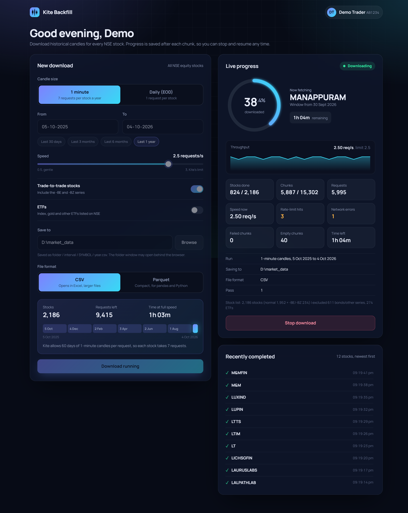
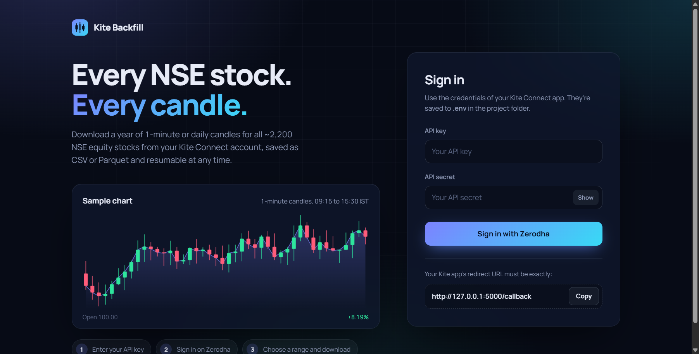
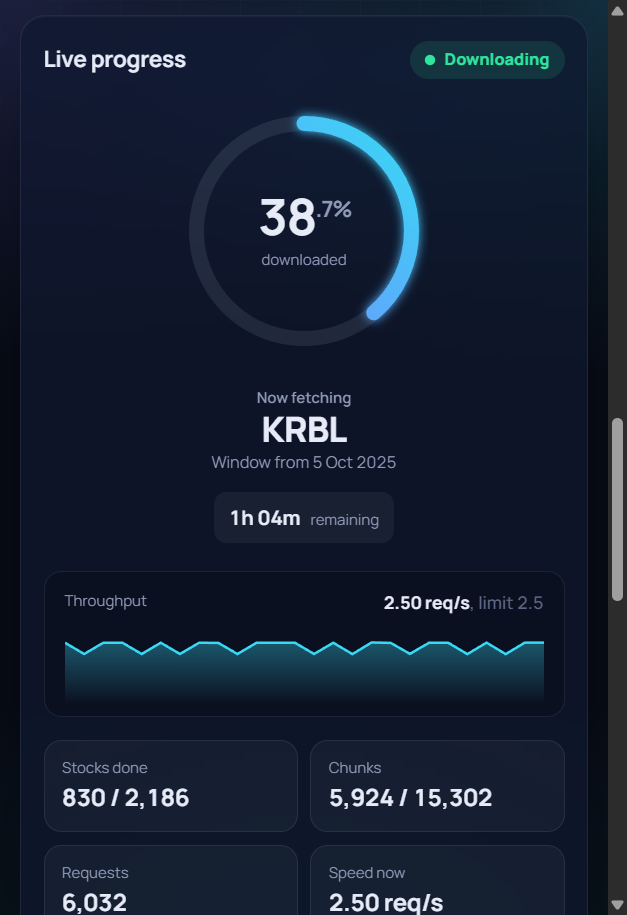

# Zerodha Historical API

A local Flask app that signs in to Zerodha Kite Connect and downloads historical candles (1-minute or daily) for every NSE equity stock (about 2,200 symbols, up to one year per run) and for the main NSE indices such as the NIFTY 50 spot (up to 20 years per run, for example from 2015). Files are saved as CSV or Parquet, downloads can be stopped and resumed, and the dashboard shows live progress. It also saves 1-minute candles with OI for every NIFTY (NSE) or SENSEX (BSE) future and option that traded on a day, for any day since the last expiry (before Kite drops expired contracts) (see [NIFTY F&O daily download](#nifty-fo-daily-download)).



## Requirements
- Python 3.10 or newer
- A Kite Connect app (the paid Kite Connect plan, Rs 500/month, which includes historical data). If Kite rejects the requests, the error appears in the dashboard.
- An internet connection (the dashboard loads React and fonts from public CDNs)

## Setup
1. Install the dependencies and start the app:
   ```
   pip install -r requirements.txt
   python app.py
   ```
   The versions in `requirements.txt` are pinned. To update a package: `pip install -U <pkg>`, run `pytest`, then put the new version in `requirements.txt`.
2. In the Kite developer console, set your app's redirect URL to exactly:
   ```
   http://127.0.0.1:5000/callback
   ```
3. Open http://127.0.0.1:5000, enter your API key and secret, and sign in with Zerodha.

   

Kite sessions expire every day, so you need to sign in again each day.

## Downloading data
1. Under **Stocks**, tick any of: **NSE equity stocks**, **NIFTY 50 spot**, **NIFTY BANK**, **NIFTY FIN SERVICE**, **NIFTY MID SELECT** and **INDIA VIX**. At least one is needed. With equity ticked, you can also include trade-to-trade stocks (`-BE`, `-BZ`) and ETFs (both off by default).
2. Choose the candle size: **1 minute** or **Daily (EOD)**.
3. Pick a date range, or use a shortcut (last 30 days, 3 months, 6 months or 1 year, or **Since 2015** when only indices are ticked). With equity ticked the range can be one year at most. With only indices ticked it can be up to 20 years.
4. Set the speed, from 0.5 to 3 requests a second (Kite's limit is 3). The app slows down automatically if Kite rate-limits it.
5. Choose a save folder and a file format: **CSV** (opens in Excel) or **Parquet** (smaller, for pandas and Python). Indices use the same format as stocks. The hint under the folder shows the name of the folder the download will create (see [Output](#output)).
6. Click **Start download**.

Before you start, the dashboard estimates the number of requests and the time the download will take. Kite returns at most 60 days of 1-minute candles per request, so a year of 1-minute data takes 7 requests per stock, about 15,000 in total, or roughly 1 h 45 min at full speed. Daily data takes one request per stock (Kite returns up to 2,000 days of daily candles per request).

### Indices (NIFTY 50 spot and others)
Indices are cheap: NIFTY 50 from 2015 to today is 3 requests for daily candles and about 72 for 1-minute candles, so it finishes in under a minute. If you tick indices and equity together, one job fetches the indices first, then the stocks. For daily and 1-minute data, run the download twice, once per candle size. Kite's 1-minute index data starts around 9 January 2015, so earlier windows come back empty and are counted as **Empty chunks**, not failures. Index candles have a volume of 0. The NIFTY 50 spot is instrument token `256265` (`NSE:NIFTY 50`).

### Live progress
While a download runs, the dashboard shows the percentage done, the part being fetched (for example "Indices: NIFTY 50", then "Equity: 1,240 / 2,942 stocks"), the symbol, the time left, the request speed, rate-limit hits and errors, the folders being written to, and a list of the stocks and indices completed so far. The browser tab title also shows the percentage.



### Stopping and resuming
Progress is saved after every request. Click **Stop download** at any time. To continue, start again with the same selection, dates, file format and save folder, and click **Resume download**. Finished chunks are skipped, and the files keep going into the folder the download started in. Requests that fail are retried automatically at the end of the run.

## Output
Each download gets its own folder, named after what was downloaded, the candle size (`1min` or `EOD`), the selected date range and the time the download started:
```
<folder>/<Equity_stocks|Index_spot>_<1min|EOD>_<from>_to_<to>_started_<date>_<HHMM>/<SYMBOL>/<year>.csv   (or .parquet)
```
For example:
```
D:\market_data\Equity_stocks_1min_2025-10-05_to_2026-10-04_started_2026-10-04_1530\RELIANCE\2026.csv
D:\market_data\Index_spot_EOD_2015-01-01_to_2026-10-04_started_2026-10-04_1530\NIFTY_50\2015.csv
```
A job with both indices and equity ticked writes two folders. Resuming a download keeps writing into the folder it started in. Spaces in index names become underscores in the folder name (`NIFTY_50`), but the `tradingsymbol` column keeps the real name (`NIFTY 50`). Indices use the same file format setting as stocks. Each file has the columns `date, open, high, low, close, volume, tradingsymbol, instrument_token`. Times are in IST. Index candles have a volume of 0.

The progress database (`progress.sqlite`) and the error log (`errors.log`) are kept directly in the save folder, next to the download folders. They record which folder each download uses, so to resume a download, choose the same save folder.

Data downloaded with older versions of the app is in `<folder>/minute/` and `<folder>/day/` and is left as it is.

## Which stocks are included
Every NSE equity (`EQ`) instrument with no series suffix, plus `-BE` and `-BZ` trade-to-trade stocks if you include them. Bonds, NCDs, government securities, T-bills, sovereign gold bonds and SME stocks are excluded, and ETFs are excluded unless you include them. The dashboard shows the exact counts once the download starts.

## NIFTY F&O daily download
Kite only serves live contracts: once a NIFTY future or option expires, its history can no longer be downloaded. This job saves one day's 1-minute candles with open interest (OI) for **every NIFTY future and option that traded that day** (all expiries and strikes), in the same file names and columns as Accelpix data so the two sets can be merged.

You can start it in two ways. Both use the same code and the same lock, so only one run can happen at a time:
- **Dashboard:** the **NIFTY F&O daily** card under New download. Pick the date yourself in the calendar (it starts empty): click one day, or click a second day to download the whole range (weekends/holidays are skipped, saved contracts are not fetched again). Or click **Download all missing days**. It has its own **Save to** field with a **Browse** button, separate from New download (it starts with the same folder).
- **Command line:** `python nifty_daily.py YYYY-MM-DD` or `python nifty_daily.py --missing`

### Which dates can be downloaded
A day can be downloaded **completely** only while every contract that existed that day is still live on Kite. That is true for every day **after the most recent expiry**. On or before it, at least one contract (that expiry) is already gone. So the allowed dates are:
```
from (previous NIFTY expiry + 1 day) to today
```
For example, on Sunday 11 Oct 2026 the previous expiry is Tuesday 6 Oct and the current week expiry is Tuesday 13 Oct, so 7, 8 and 9 Oct (and the weekend, which the holiday check skips) can be downloaded and 6 Oct cannot. Any date inside the window gives a complete day. Dates outside it are refused with a message such as *Earliest date available is 2026-10-07. Contracts that expired on 2026-10-06 are no longer served by Kite.*

How the previous expiry is found:
- **From history** (normally). Every run adds the NIFTY expiries in that day's instrument list to `NIFTY_FnO_1min/expiries_seen.csv`. The previous expiry is the latest one before the current week expiry (the earliest live expiry).
- **Fallback** (no history yet, or history too old to cover the previous week): the last weekly expiry weekday before the current week expiry. The weekday is `WEEKLY_EXPIRY_WEEKDAY` in `.env` (default `TUE`; SENSEX: `WEEKLY_EXPIRY_WEEKDAY_SENSEX`, default `THU`). For example, a current week expiry moved to Monday 19 Oct by a holiday gives Tuesday 13 Oct, so the earliest date is 14 Oct. The run log shows a WARNING that the earliest date is estimated. The fallback can only be too cautious, by at most one day, when the previous expiry was itself moved to a Monday.

Other rules:
- The date is never filled in for you. For today's date, the run starts only from **15:40 IST**. On expiry day the card warns: *Today is expiry. Run after 15:40 or this contract's data is lost.*
- At startup the job calls `kite.profile()` to check the access token. If the token is invalid, the job stops and the CLI exits with code 2.
- The job fetches today's instrument list and keeps NIFTY FUT/CE/PE contracts with an expiry on or after the chosen date. Today's list also has strikes and expiries added after a past day, so by default the job then keeps only the contracts in that day's exchange bhavcopy (see the next point). Each contract is fetched for that date, 09:00 to 16:00 IST, with OI. Every row Kite returns is kept, including pre-open and post-close rows. Requests are throttled (2.5 requests/s by default, at most 3), and network errors and rate limits are retried up to 3 times.
- A contract with no candles gets **no file** (counted as "No candles" in `run.log`).
- Kite can report a contract that traded only once as candles with the right price and OI but volume 0 on every bar (it builds volume from changes in the day's cumulative volume). The switch **Keep contracts with candles but zero volume** (CLI `--keep-zero-volume` / `--no-keep-zero-volume`; default ON for NIFTY and SENSEX, Kite and Dhan, so runs save to `with_zero_volume`; set `KEEP_ZERO_VOLUME=OFF` in `.env` or `KEEP_ZERO_VOLUME` in `config.py` to change it) decides whether they get a file. Kept rows are saved exactly as Kite returns them. Either way they are listed in `<day folder>/zero_volume_contracts.csv` (`Contract, Candles, Last_close, Last_OI, Kept`), `run.log` shows "Zero-volume candles: kept N / skipped N", and the setting is recorded in `run.log` and in summary.csv's `Keep_zero_volume` column.
- **Download only contracts in the bhavcopy** (on by default, Kite and Dhan alike; CLI `--trim-to-bhav` / `--no-trim-to-bhav`; set `TRIM_TO_BHAV=OFF` in `.env` or `TRIM_TO_BHAV` in `config.py` to change the default): before downloading, the job gets the day's F&O bhavcopy (NSE for NIFTY, BSE for SENSEX; the copy already saved in `<day folder>/bhavcopy/`, else a download of at most 30 seconds, saved there and reused by the bhavcopy check after the run) and requests only the contracts listed in it, traded or not. Contracts Kite lists today that did not exist on that day are not requested, so they don't waste requests or show up as EXTRA in the check.
  - When the bhavcopy is not available (not published yet, usually until the evening; 404; an error; slower than 30 seconds) the full list is used. The run is never refused for this. The job message on the live card and the command line say `Bhavcopy not available (<reason>): full contract list used`.
  - `run.log` records each run's choice: `Contracts: trimmed to bhavcopy (kept N of M)`, `Contracts: full list (trim OFF)` or `Contracts: full list (bhavcopy not available: <reason>)`. summary.csv's last column `Trim_to_bhav` holds the last run's result: `ON`, `OFF` or `FALLBACK` (blank for days saved before it existed).
  - Running a day again skips saved contracts as always, and nothing is ever deleted: a day first downloaded with the full list and run again with the setting ON keeps its extra files, which the bhavcopy check shows as EXTRA.
  - A single-contract **Re-download** is not affected. **Re-check no-trade contracts**, ranges and **Download all missing days** use the setting for every day.
- **Re-check no-trade contracts for <date>** (switch ON, a saved day; CLI `python nifty_daily.py --refetch-no-trade YYYY-MM-DD`) requests every contract of that day without a file again, skipping those with a file, then re-runs the bhavcopy check if the bhavcopy is saved. Use it for days saved before the switch existed, while their contracts are still live.
- If the nearest future has no candles, the job asks Kite for the spot index (NIFTY 50 / SENSEX). If the spot has candles, the market was open: the future just did not trade (this happens with BSE's thin SENSEX futures), so it is skipped like any other untraded contract and the day goes on. If the spot is empty too, the day is treated as a **market holiday** or weekend. The day is recorded in `<UNDERLYING>_FnO_1min/holidays.log`, the day folder is removed and the job exits cleanly. **Download all missing days** skips days already in that log.
- A contract that fails, whether from a Kite error or an unexpected strike that can't be named, is marked failed and the run continues. Failed contracts are retried once at the end. Running a day again skips everything already saved, so you can re-run safely after a crash.
- **Missing days** are dates in the window without a complete folder (`summary.csv` written and no failed contracts), excluding logged holidays and today before 15:40. They are downloaded one after another, oldest first, with the same lock and rate limit.

### Folder layout
```
<save folder>/NIFTY_FnO_1min/
    expiries_seen.csv      (every NIFTY expiry seen so far, with the date it was first seen)
    holidays.log
    _DAYS-5_2026-10-07_to_2026-10-13.txt   (day count; the leading _ keeps it at the top in Explorer)
    days_index.csv                         (the same list as a table)
    2026-10-12_exp-2026-10-13_withZeroVol_dl-2026-10-13_2319/
        futures/NIFTY27OCT26.csv  NIFTY24NOV26.csv  NIFTY29DEC26.csv
        options/NIFTY2500013OCT26CE.csv  NIFTY1200029DEC26PE.csv  ...
        instruments_NFO.csv   (the raw Kite instrument list; instruments_NFO_fetched_<date>.csv
                               when the day was downloaded later, since the list is from that date)
        summary.csv
        run.log
```
#### Day folder names
Each day folder is named `<trading day>_exp-<nearest option expiry>_<withZeroVol|noZeroVol>_dl-<download date>_<HHMM>`, for example:
```
NIFTY_FnO_1min/2026-10-12_exp-2026-10-13_withZeroVol_dl-2026-10-13_2319/futures/NIFTY27OCT26.csv
NIFTY_FnO_1min_Dhan/2026-10-12_exp-2026-10-13_noZeroVol_dl-2026-10-14_0905/...
SENSEX_FnO_1min/2026-10-15_exp-2026-10-15_withZeroVol_dl-2026-10-15_1812/...
```
- **Trading day** comes first, so folders still sort by date.
- **exp** is the nearest option expiry on or after the trading day. It is taken from the run's full instrument list (Kite or Dhan), before the list is trimmed to the bhavcopy. On an expiry day it is the day itself, and NIFTY and SENSEX each use their own expiries. If the list has no option expiry on or after the day, the run stops and creates nothing.
- **withZeroVol / noZeroVol** is the **Keep contracts with candles but zero volume** setting. Once any run with the setting ON has written the day, it is `withZeroVol`: a later OFF run never deletes those files. So a `noZeroVol` folder is renamed to `withZeroVol` at the end of an ON run, a **Re-check no-trade contracts** run, or a contract re-download with the setting ON. That is the only rename ever made, and an OFF run never renames a `withZeroVol` day. If Windows refuses the rename (the folder is open in Explorer), the job message says so and the next ON run tries again. Inside the `with_zero_volume` / `without_zero_volume` stores (see [F&O backtest store](#fo-backtest-store)) there is no rename: each store holds one setting, and the without copy of a day is derived instead.
- **dl** is when the folder was first created (IST, `YYYY-MM-DD_HHMM`; Windows does not allow colons). It never changes.
- Resuming a day, **Download all missing days**, re-downloading a contract and the bhavcopy check find the folder by its date and reuse it. Each later run adds its start time and zero-volume setting to `run.log`.
- Two folders for the same trading day stop every run and check with an error that lists them; keep one.
- Holidays still create no day folder. The bhavcopy check refuses a day that was never downloaded ("download it first").

#### Day count
Each F&O root has one `_DAYS-<count>_<first day>_to_<last day>.txt` (`_DAYS-0.txt` when it is empty) and a `days_index.csv`. They are only for looking at; nothing reads them back, except the dashboard's "Saved days" line.
- The .txt starts with a totals line, e.g. `5 days (withZeroVol 3, noZeroVol 2), 2026-10-07 to 2026-10-13, updated 2026-10-14 09:12 IST`, then one line per day.
- Each day's line gives its folder, expiry, zero-volume setting, download time, the number of futures and option files, and `Trim_to_bhav` from the day's summary.csv (`ON` / `OFF` / `FALLBACK`, blank for older days). The trim is never part of the folder name.
- `days_index.csv` has the same data (`Day, Folder, Expiry, Zero_volume, Downloaded, Futures_files, Option_files, Trim_to_bhav`).
- Both are rewritten after a run that creates, renames or removes a day folder, after `--rename-folders --apply`, and by `python nifty_daily.py --update-day-count`. Old-style folders count too.
- The count is not in the root folder's name: Windows can't rename a folder while the download lock file inside it is open.

#### Older folders
Days saved before this change are named just `YYYY-MM-DD`. Everything still reads them. To rename them:
```
python nifty_daily.py --rename-folders                 # dry run: prints old -> new, changes nothing
python nifty_daily.py --rename-folders --apply         # renames (folders only; files inside are untouched)
python nifty_daily.py --rename-folders --underlying NIFTY --source kite --folder D:\market_data
python nifty_daily.py --update-day-count               # rewrite every root's _DAYS-*.txt and days_index.csv
```
Both commands work on every underlying and source unless you name one.
- **exp** comes from the day's `summary.csv` ("Current week" row), else from `expiries_seen.csv`.
- **Zero-volume setting**: `withZeroVol` if `summary.csv`'s `Keep_zero_volume` is ON, or `run.log` shows any run with it ON, or `zero_volume_contracts.csv` has a kept row. It is `noZeroVol` if `summary.csv` says OFF or `run.log` shows only OFF runs.
- **dl** is the first run's start time in `run.log`, else the folder's creation time.
- A folder whose expiry or zero-volume setting can't be told is skipped and listed. Each line says where every part came from.
- It takes the same lock as downloads (the dry run too), so it refuses while a download runs.
- With `--apply`, the first error stops it and lists what was already renamed. After a successful `--apply` it writes the day count.

File names are built from each contract's expiry and strike, not from Kite's tradingsymbol:
- Futures: `NIFTY{DD}{MON}{YY}`, for example `NIFTY27OCT26`
- Options: `NIFTY{strike}{DD}{MON}{YY}{CE|PE}`, for example `NIFTY1200029DEC26PE`

Each CSV has the header `Ticker,Date,Time,Open,High,Low,Close,Volume,OI`, with one row per minute exactly as Kite returns it and no forward-filling. Times are in IST:
```
NIFTY27OCT26,20261012,09:15:00,25120.5,25140,25110,25135,58955,14046305
```

`summary.csv` has one row per option expiry plus one `Futures` row per future expiry: `Expiry, Bucket, Listed_strikes, Traded_strikes, Listed_contracts, CE_files, PE_files, ATM_strike, ATM_CE_bars, ATM_PE_bars`, then six bhavcopy columns (see [Check against the NSE bhavcopy](#check-against-the-nse-bhavcopy)), then `Keep_zero_volume` and `Trim_to_bhav`. `Listed_strikes` and `Listed_contracts` (CE + PE) count the contracts the run requested for that expiry: those in the bhavcopy when `Trim_to_bhav` is ON, else everything the broker lists. `Traded_strikes` (strikes with a CE or PE file), `CE_files` and `PE_files` count the files in the day's `options/` folder at the end of the run, including files saved by an earlier, resumed run, so they match counts of traded contracts such as the NSE bhavcopy. An expiry where nothing traded still gets a row, with `Traded_strikes` 0. The ATM strike is the 09:15 close of the nearest future, rounded to 50. The buckets are: nearest option expiry "Current week", second "Next week", nearest future expiry "Current month", second "Next month". One expiry can carry two labels, and all other expiries are "Far". An ATM bar count is 0 when that contract had no trades, and blank when it isn't listed. `run.log` also lists each future's bars, its open, high, low and close between 09:15 and 15:30, its total volume and its last OI, as well as every failure with its instrument token and error.

### Manual run
The job reads `KITE_ACCESS_TOKEN` from `.env`. Kite tokens expire every day, so sign in on the dashboard before each run.
```
python nifty_daily.py 2026-10-12                       # one day (today's date: after 15:40 IST)
python nifty_daily.py 2026-10-12 --folder D:\market_data --speed 2.5
python nifty_daily.py --missing                        # every allowed day without a complete folder
python nifty_daily.py --refetch-no-trade 2026-10-07     # contracts of a saved day without a file, again
python nifty_daily.py 2026-10-12 --no-trim-to-bhav      # every contract Kite lists, not only the bhavcopy's
python nifty_daily.py --inspect NIFTY2415013OCT26PE 2026-10-07   # Kite's raw candles; writes nothing
python nifty_daily.py --inspect-missing 2026-10-07      # the same for each MISSING_IN_KITE contract
```
Exit codes: `0` finished or market holiday, `1` some contracts failed or the job did not run (too early, bad arguments, another run in progress), `2` access token missing or invalid, `3` date outside the allowed window.

### Check against the NSE bhavcopy
The NSE F&O bhavcopy is the exchange's official end-of-day record of every contract: OHLC, last price, settlement price, volume and OI. Checking a saved day against it confirms that every NIFTY contract that traded got a file, and that the saved volume, OI and last price agree. It also keeps the settlement prices, which you need for expiry-day P&L, and an EOD record if a Kite day is ever lost. NSE keeps the bhavcopy archive permanently, so the check isn't urgent. **Every Kite F&O download (one day, a range, or all missing days) fetches and checks the day's bhavcopy automatically** when NSE has published it (usually in the evening); otherwise the day stays pending and the reason is written to `run.log` and `NIFTY_FnO_1min/bhavcopy.log`. You can also run it by hand any time:
```
python nifty_bhav.py 2026-10-09 --folder D:\market_data
python nifty_bhav.py --missing --folder D:\market_data              # every saved day without a check yet
python nifty_bhav.py 2026-10-09 --bhav-file C:\Downloads\BhavCopy_NSE_FO_0_0_0_20261009_F_0000.csv.zip
python nifty_bhav.py --export 2026-10-07          # Excel report into <day folder>/bhavcopy/exports/
python nifty_bhav.py --export 2026-10-07 --csv    # every contract as CSV
python nifty_bhav.py --export-days                # one row per checked day, into NIFTY_FnO_1min/
```
You can also click **Check vs NSE bhavcopy** on the F&O card, for the date picked there. The card shows the result for that date: `Bhavcopy check: OK`, `Bhavcopy check: CHECK (3 missing, 2 OI diffs)` or `Bhavcopy: pending`.

The **Bhavcopy check** card under the F&O card lists every saved day in the F&O card's folder, newest first. Each row shows Date, Status, Bhav traded, Kite files, Missing, Extra, Volume diffs, OI diffs and Price diffs, coloured green for OK, red for CHECK and grey for pending.
- **Check now** on a pending day runs the check for that date. **Check all pending** does every pending day, the same as `--missing`.
- Clicking an OK or CHECK day lists only the contracts that aren't OK, with bhavcopy and Kite volume (both in shares), OI, last price and status.
- A missing contract that hasn't expired gets a **Re-download** button. It fetches just that contract for that day, then re-runs the comparison from the saved bhavcopy. This uses the same lock and rate limit, and needs the day's Kite sign-in.

**Download** menus export what the check saved, without comparing again or changing any file:
- Next to the day table, **All days summary (CSV)**: one row per checked day (`bhavcopy_check_all_days_<today>.csv`) with Date, Status, Liquid_missing, Liquid_diffs, Bhav_traded, Kite_files, Missing, Extra, Volume_diffs, Zero_volume_in_kite, OI_diffs, Price_diffs and Toggle_keep_zero_volume. Every check also saves the checked day's row by itself as `<day folder>/bhavcopy/checked_days_summary.csv` (that day only; the download is the list of all days).
- Above a day's difference list: **This view (CSV)**, the rows shown for the chosen bucket in the same order (`bhavcopy_check_<date>_<bucket>.csv`, e.g. `_current_week`); **All contracts for this day (CSV)**, including OK ones (`_all_contracts.csv`); and **Full report (Excel)** (`bhavcopy_check_<date>.xlsx`) with sheets Summary (the day row and one row per expiry), Not OK, All contracts and Settlement (bhavcopy close, settlement price and OI per contract, for backtest P&L), each with a frozen header row, filters and fitted columns.

Contract rows have Expiry and Bucket, and one value per column: Bhav_volume (contracts), Bhav_volume_shares, Kite_volume, Bhav_OI, Kite_OI, Bhav_last, Kite_last, Kite_regular_close (the 15:29 bar), Kite_last_bar_time, Bhav_close, Bhav_settle, Status and Status_note. Numbers are plain (`2036458500`, never `2,03,64,58,500`), dates are YYYY-MM-DD, and each CSV starts with its header, so Excel and `pandas.read_csv` read them directly. A day without a check gives an error instead of a file.

A red banner at the top of the dashboard appears if any of the last 10 saved days is CHECK. A yellow banner appears if a day older than yesterday hasn't been checked, with a **Check all pending** button.

The file is downloaded from `https://nsearchives.nseindia.com/content/fo/BhavCopy_NSE_FO_0_0_0_<YYYYMMDD>_F_0000.csv.zip`, with 3 tries. If NSE blocks the download (it sometimes does, especially from cloud servers), download the zip in a browser and pass it with `--bhav-file`. A zip or a CSV both work. A 404 means the file isn't published yet, or there was no trading that day. In that case only a line in `NIFTY_FnO_1min/bhavcopy.log` is written, and the exit code is 4.

The check uses the same lock as the Kite download, so the two never run at the same time. It writes into `<day folder>/bhavcopy/`:
- the bhavcopy zip exactly as downloaded, and `nifty_bhav.csv` (the NIFTY index future and option rows, in NSE's columns)
- `bhav_compare.csv`, one row per contract in the bhavcopy and per file on disk: `Contract, Expiry, Bucket, Type, Strike, Bhav_volume, Kite_volume, Bhav_OI, Kite_OI, Bhav_last, Kite_last, Kite_last_regular, Last_bar, Bhav_close, Bhav_settle, Status, Note`
- `bhav_check.json` with the result, counts and units
- `bhav_summary.csv`: an `ALL` row (date, status, volume/OI units and totals), then one row per expiry and type (FUT/OPT) with Bhav_contracts, Bhav_traded, Kite_files, OK, Missing, Extra, Zero_volume, Volume_diffs, OI_diffs and Price_diffs
- `checked_days_summary.csv`: this day's row only, in the columns of the dashboard's "All days summary (CSV)"

There are no separate files per difference type: filter `bhav_compare.csv` by `Status`, or use the dashboard's Download menu (per bucket, or the Excel report). Days checked before this change may still have the old `missing_in_kite.csv`, `price_diff.csv`, … files; they are no longer written or read and can be deleted.

The `Status` values:
- `OK`: no problems found.
- `MISSING_IN_KITE`: traded in the bhavcopy, but there is no file. This is a real gap.
- `EXTRA_IN_KITE`: there is a file, but the bhavcopy shows no volume for the contract, or doesn't list it.
- `ZERO_VOLUME_IN_KITE`: there is a file (a kept zero-volume contract) but Kite's total volume is 0 while the bhavcopy shows trades. It counts as a volume difference, not as missing, and is always amber (a known Kite limitation), even when it also gets `VOLUME_DIFF`.
- `VOLUME_DIFF`: the day's total volume differs by more than 1% **and** by more than 5 lots, so small contracts aren't flagged for a few lots.
- `OI_DIFF`: the last OI differs by more than 3%. Kite's OI is an intraday snapshot, while the bhavcopy's is the official end-of-day figure.
- `PRICE_DIFF`: NSE's last price doesn't match the close of Kite's **last bar of the day**, whatever its time, within 0.5% or 2 ticks. Kite labels candles by their start time, so the 15:30 candle already belongs to the post-close session. `Kite_last_regular` is the close of the last candle starting before 15:30 (the 15:29 candle), for reference. `Last_bar` is the start time of Kite's last bar. If that is before 15:40 and the prices differ, `Note` says "trades after Kite's last bar".
- `BAD_NAME`: the bhavcopy row can't be turned into a file name.

Several statuses are joined with `+`.

Every row has a **Bucket** for that day:
- Options: the nearest option expiry is Current week and the second is Next week. The expiry of the nearest future is Current month and the second future's is Next month. An expiry can carry two labels, such as `Next week + Current month`.
- Futures: Current month, then Next month.
- Everything else is Far.

All buckets except Far count as **liquid**. The status line adds a headline for them after the overall counts, for example `Bhavcopy check: CHECK (1112 missing); liquid buckets: 707 missing, 0 diffs`. On the dashboard:
- A day is red only when a contract is `MISSING_IN_KITE` (in any bucket) or has a `VOLUME_DIFF` over these limits while Kite's volume is above 0. The known Kite limitations, `ZERO_VOLUME_IN_KITE`, `EXTRA_IN_KITE`, `OI_DIFF` and `PRICE_DIFF` (including "trades after Kite's last bar"), make it amber ("CHECK (minor)") in every bucket, liquid ones included.
- A day's difference list is sorted by bhavcopy volume, biggest first, and can be filtered by bucket.

Grouping never hides anything: every difference still has its row, counts in the totals, and gives exit code 1. Checks made before buckets were added show as red until they are checked again. A futures close (`ClsPric`) is a calculated price on NSE, so it is stored but not compared. The bhavcopy counts volume in contracts and OI in shares, while Kite uses shares for both, so the units are worked out from the futures every time (the volume multiplier is the lot size) and noted in `bhav_check.json`.

The check also fills six columns of the day's `summary.csv`: `Bhav_traded_contracts, Kite_files, Missing_in_kite, Extra_in_kite, OI_diffs, Price_diffs`. There is one row per option expiry and one `Futures` row per future expiry. Until a check has run, these columns are blank and `run.log` ends with `Bhavcopy: pending`. Downloading the day again keeps the check. Exit codes: `0` OK, `1` differences found (or the check couldn't run), `4` bhavcopy not available yet.

### Reading the data in a backtest
`backfill/fno_loader.py` reads the saved files back into pandas, with a leading `Datetime` column (IST, tz-naive):
```python
from backfill.fno_loader import load_contract, load_day, load_eod
fut = load_contract(r"D:\market_data", "NIFTY27OCT26")         # one contract, every saved day
day = load_day(r"D:\market_data", "2026-10-12")                # every contract of one day
opts = load_day(r"D:\market_data", "2026-10-12", kind="options")
eod = load_eod(r"D:\market_data", "2026-10-12")                # NSE bhavcopy of the day
```
**OI gaps:** a minute with OI 0 in a contract that has non-zero OI earlier or later that day is treated as missing and filled from the previous minute; those rows have `OI_filled = True`. Zeros before the day's first non-zero OI stay empty (NaN), a contract with OI 0 all day keeps its 0s, and filling never crosses days. Pass `fill_oi=False` for the values exactly as saved. The CSV files themselves are never changed.

For the **end-of-day close, settlement price and final OI**, use the bhavcopy, not the last 1-minute bar. Kite's last bar and its OI are intraday snapshots, while the bhavcopy is NSE's official record. `load_eod()` returns the bhavcopy saved by the check, with our contract names: `Contract, Expiry, Type, Strike, Close, Last, Settle, OI, Volume_contracts, Lot`. OI is in shares and volume in contracts, as NSE publishes them. Run the bhavcopy check for a day before loading it.

### SENSEX F&O (BSE)
SENSEX works exactly like NIFTY, from Kite's BFO exchange, with BSE's F&O bhavcopy instead of NSE's. On the dashboard, switch the **Index** control on the F&O card to **SENSEX** (the choice is remembered in the browser); the date picker, missing days, Download / Re-check buttons and the **Bhavcopy check** card below then all work on SENSEX. From a terminal, add `--underlying SENSEX`:

```
python nifty_daily.py 2026-10-12 --underlying SENSEX
python nifty_daily.py --missing --underlying SENSEX
python nifty_bhav.py 2026-10-12 --underlying SENSEX
```

- Files go to `<save folder>/SENSEX_FnO_1min/<day folder>/{futures,options}/` with names such as `SENSEX29OCT26.csv` and `SENSEX7470015OCT26CE.csv`, plus `instruments_BFO.csv`, `summary.csv` and `run.log`; the ATM strike is rounded to 100.
- SENSEX's weekly expiry is Thursday. The date-window fallback uses `WEEKLY_EXPIRY_WEEKDAY_SENSEX` in `.env` (default `THU`); NIFTY uses `WEEKLY_EXPIRY_WEEKDAY_NIFTY` or the older `WEEKLY_EXPIRY_WEEKDAY` (default `TUE`).
- The bhavcopy comes from `https://www.bseindia.com/download/Bhavcopy/Derivative/BhavCopy_BSE_FO_0_0_0_<YYYYMMDD>_F_0000.CSV`, a plain CSV with the same columns as NSE's. BSE answers a day it hasn't published with its web page instead of a 404; that counts as "not published yet" (pending, exit code 4). The CSV is saved as downloaded next to `sensex_bhav.csv` in `<day folder>/bhavcopy/`, with the same `bhav_compare.csv`, `bhav_check.json`, `bhav_summary.csv` and `checked_days_summary.csv`.
- BSE gives volume and OI both in shares (NSE gives volume in contracts); the units are detected per day as before. `load_eod(..., underlying="SENSEX")` still returns `Volume_contracts` (BSE volume divided by the lot).
- CSV/Excel downloads of a SENSEX check end in `_sensex` (e.g. `bhavcopy_check_2026-10-12_sensex.xlsx`).
- SENSEX is Kite only; the Dhan page stays NIFTY.

Other underlyings are added in `UNDERLYINGS` (Kite exchange, strike step) and `EXCHANGE_OF` (whose bhavcopy) in `backfill/fno.py`.

## Dhan F&O download (optional)
The **Dhan** tab on the sign-in page (`http://127.0.0.1:5000/dhan`) connects a Dhan account with an access token and opens a Dhan page with the same **NIFTY | SENSEX** Index switch as the Kite dashboard: NIFTY from Dhan's NSE F&O list, SENSEX from its BSE F&O list. It downloads one day's 1-minute candles with open interest for every live future and option of the index (all weekly and monthly expiries, every strike), the same job as the Kite F&O card, but from Dhan's Data API.

1. On web.dhan.co, generate an access token under your profile's DhanHQ Trading APIs. Historical candles need an active Dhan Data API subscription.
2. Open http://127.0.0.1:5000, click the **Dhan** tab, enter your Dhan Client ID, paste the token and click **Connect Dhan**. The app checks the token with Dhan (it must belong to that Client ID), saves it with its validity and opens the Dhan F&O page.
3. Pick a date or a range (previous expiry + 1 to today, after 15:40 IST for today), a save folder and a speed (up to 5 requests/s, Dhan's limit), then **Download F&O**, or **Download all missing days**.

Files go to `<save folder>/NIFTY_FnO_1min_Dhan/` or `SENSEX_FnO_1min_Dhan/`, then `<day folder>/{futures,options}/`, in the same CSV layout as the Kite files (plus `summary.csv`, `run.log`, `zero_volume_contracts.csv` and `instruments_NSE_FNO.csv` / `instruments_BSE_FNO.csv`), so Kite and Dhan data never overwrite each other. Dhan's instrument list also has far strikes the exchange did not list that day; **Download only contracts in the bhavcopy** works exactly as on Kite (the same switch, setting and `--trim-to-bhav` / `--no-trim-to-bhav` flags; see [Which dates can be downloaded](#which-dates-can-be-downloaded)). The two brokers differ only in the speed limit, Dhan's data-plan check and the folder. Running a day again skips saved contracts. Dhan tokens expire: paste a new one on the Dhan tab and start again.

The Dhan page has the same **Bhavcopy check** as the Kite dashboard (Check vs NSE / BSE bhavcopy, the checked-days table, differences per contract with the bucket filter, Re-download for live contracts, and the CSV/Excel downloads), working on the Dhan folder; its tables and files say Dhan instead of Kite (`Dhan_volume`, `MISSING_IN_DHAN`, file names ending `_dhan`). **Log out** (top right) removes the Dhan token from `.env`.

Everything the Kite NIFTY and SENSEX F&O sections do works on Dhan too:
- **Bhavcopy after every day:** each Dhan download (one day, a range or all missing days) saves the NSE (NIFTY) or BSE (SENSEX) bhavcopy into `<day folder>/bhavcopy/` and checks the day (`bhav_compare.csv`, `bhav_check.json`, `bhav_summary.csv`, `checked_days_summary.csv`). The download reuses the bhavcopy it fetched for the contract list. When the exchange hasn't published yet, the day stays pending and `<INDEX>_FnO_1min_Dhan/bhavcopy.log` says why.
- **Holiday check:** as on Kite, an untraded nearest future is checked against the index itself before a day is called a holiday.
- **Re-check no-trade contracts for <date>** (switch ON, a saved Dhan day) requests every contract of that day without a file again, then re-checks the day.
- **Command line:** add `--source dhan`, plus `--underlying SENSEX` for SENSEX (it uses the Dhan token saved by the Dhan tab and needs an active Data API plan; speed up to 5):

```
python nifty_daily.py 2026-10-12 --source dhan
python nifty_daily.py --missing --source dhan
python nifty_daily.py --refetch-no-trade 2026-10-12 --source dhan
python nifty_daily.py --inspect NIFTY2500013OCT26PE 2026-10-12 --source dhan
python nifty_daily.py --inspect-missing 2026-10-12 --source dhan
python nifty_bhav.py 2026-10-12 --source dhan      # also --missing, --bhav-file, --export, --export-days
python nifty_daily.py 2026-10-13 --source dhan --underlying SENSEX
python nifty_bhav.py 2026-10-13 --source dhan --underlying SENSEX
```

  Exit codes are the same as for Kite (2 = Dhan token missing, expired or refused).
- **Backtests:** `load_day`, `load_contract` and `load_eod` take `source="dhan"` to read `NIFTY_FnO_1min_Dhan/` (with `underlying="SENSEX"`, `SENSEX_FnO_1min_Dhan/`).

## F&O backtest store
F&O data lives in two places: **raw**, the folders the app downloads into (format unchanged), and **backtest**, Parquet files built from raw by `publish` that backtests read. Equity is not part of this.

Both keep two versions of every day apart: **with zero volume** (contracts whose candles all have volume 0 are saved: "Keep contracts with candles but zero volume" ON) and **without zero volume** (those contracts get no file: OFF).

```
D:\Data\fno\
├── raw\
│   ├── kite\                          FNO_RAW_KITE (the base)
│   │   ├── with_zero_volume\          save folder: NIFTY_FnO_1min\, SENSEX_FnO_1min\, progress.sqlite
│   │   └── without_zero_volume\       save folder: the same roots, its own progress.sqlite
│   └── dhan\                          FNO_RAW_DHAN
│       ├── with_zero_volume\          NIFTY_FnO_1min_Dhan\, SENSEX_FnO_1min_Dhan\, progress.sqlite
│       └── without_zero_volume\
└── backtest\                          FNO_BACKTEST_DIR; built from raw\ by publish, can be deleted and rebuilt
    ├── with_zero_volume\
    │   ├── NIFTY\
    │   │   ├── minute\kite\<YYYY>\<YYYY-MM-DD>.parquet
    │   │   ├── minute\dhan\<YYYY>\<YYYY-MM-DD>.parquet
    │   │   ├── eod\<YYYY>.parquet
    │   │   ├── contracts.parquet, expiries.csv, days.csv, publish_manifest.json
    │   └── SENSEX\                    (the same layout)
    └── without_zero_volume\           (the same layout)
```

Each store is an ordinary save folder (its own roots, `.lock`, `progress.sqlite`, `expiries_seen.csv`, `holidays.log`, day count). Day folders keep their names: `..._withZeroVol_...` in the with store, `..._noZeroVol_...` in the without store.

### Which store a download goes to
- When the folder is the base (`FNO_RAW_KITE` / `FNO_RAW_DHAN`: the F&O cards' start folder and the CLIs' default), the keep zero-volume setting picks the store: ON -> `with_zero_volume`, OFF -> `without_zero_volume`. This holds for the Kite and Dhan F&O cards (the card shows "Saving to ...\with_zero_volume" and changes it with the switch; the bhavcopy table shows that store's days), `nifty_daily.py` (`--keep-zero-volume` / `--no-keep-zero-volume`, else `KEEP_ZERO_VOLUME`, default ON), `--refetch-no-trade` (always the with store), re-download, `--inspect`, and `nifty_bhav.py` (same flags, they only pick the store).
- Any other folder (typed in the card, or `--folder`) is used as it is, as before.
- A run into a store of the other setting (ON into `without_zero_volume`, OFF into `with_zero_volume`) is refused. Inside the stores a folder is never renamed `noZeroVol` -> `withZeroVol`; that rename is kept only for folders outside this layout.
- Without `FNO_RAW_KITE` / `FNO_RAW_DHAN` there are no stores and everything works as before.

### The without copy: derived from the with day
**Without = with minus the zero-volume contract files.** A run with the setting OFF writes exactly the files of a run with it ON, except the contracts whose candles all have volume 0 (Kept = Y in `zero_volume_contracts.csv`). So the without version of a day can be made from the with version without downloading again, also for days that can no longer be downloaded. The reverse is impossible: an OFF run never fetched those contracts.

- **Automatically:** after a day finishes with keep zero-volume ON in the with store (a download, Re-check no-trade, or a re-download), its without copy is written into the without store, unless that store already has the day. Setting `DERIVE_WITHOUT_ZERO_VOLUME` (default ON; `.env` ON/OFF overrides), dashboard switch "Also save a without-zero-volume copy" (shown with keep zero-volume ON), CLI `--derive-without` / `--no-derive-without`. A day with failed contracts is not derived (run it again first).
- A day the without store already has (e.g. a real OFF download) is **never overwritten**; it is compared instead, and run.log and the job message say "Without copy already present (...): identical" or "differs: N files (...)".
- The copy: the folder name with `withZeroVol` -> `noZeroVol` (same exp and dl), every file except the zero-volume contract files, `zero_volume_contracts.csv` with Kept = N, `summary.csv` counted again from the files with `Keep_zero_volume` OFF (`Trim_to_bhav` unchanged), the bhavcopy checked again from the saved file (no network; zero-volume contracts become MISSING_IN_KITE instead of ZERO_VOLUME_IN_KITE), a line "Derived from <with folder> on <time>: removed N zero-volume contracts" in run.log and `derived_from.txt` naming the with folder. The day's `progress.sqlite` rows go into the without store, the zero-volume contracts DONE with reason ZERO_VOLUME, so a later OFF run doesn't request them again. It is built in `<folder>.part` and renamed into place; an error removes the `.part`.
- A contract counts as zero-volume when its file's total volume is 0, and that must agree with `zero_volume_contracts.csv`; if it doesn't, the day is listed as an error and nothing is written.

```
python fno_store.py derive-without --source kite                      # dry run: each day and how many files it removes
python fno_store.py derive-without --source dhan --underlying SENSEX --from 2026-10-09 --to 2026-10-15 --apply
python fno_store.py compare-variants --source dhan --underlying NIFTY  # derive into a temp folder, compare with real OFF days
```
- `derive-without` handles every with day the without store lacks; old-style and `noZeroVol` days are skipped and listed, as are days only in the without store ("no with copy (can't be derived)"). It takes both roots' `.lock`.
- `compare-variants` checks the rule on real data: for each day with both a with and a without download, it derives the with day into a temporary folder and compares the contract files (names and contents) with the real without day. It prints identical, or the differences (up to 20 names per kind). Nothing is written in raw; exit 1 when a day differs.
- Both take `--with PATH` / `--without PATH` to use other folders than the stores of `FNO_RAW_<SOURCE>`.

### Settings
Optional keys in `.env`:

| Key | Used for |
|---|---|
| `FNO_RAW_KITE` | Base of the Kite stores: start folder of the Kite F&O card, default `--folder` of `nifty_daily.py` / `nifty_bhav.py` (its store of the keep zero-volume setting), base of `move-raw --variant`, `split-stores`, `derive-without`, `compare-variants` and `--raw-kite` of `publish` |
| `FNO_RAW_DHAN` | The same for Dhan (`--source dhan`, the Dhan F&O card, `--raw-dhan`) |
| `FNO_BACKTEST_DIR` | Base of the published stores: default `--out` of `publish` and `root` of the backtest loader |
| `DERIVE_WITHOUT_ZERO_VOLUME` | ON/OFF: save the without copy after a with run (default ON, `config.DERIVE_WITHOUT_ZERO_VOLUME`) |

When `FNO_RAW_KITE` / `FNO_RAW_DHAN` are not set, everything uses `KITE_DATA_DIR` as before. When they are set, starting an F&O download no longer changes `KITE_DATA_DIR`, which stays the **New download** folder.

### Moving existing downloads (once)
```
python fno_store.py move-raw --from "D:\Data\Kite API data\with zero volume v2" --source kite --to "D:\Data\fno\raw\kite"
python fno_store.py move-raw --from "D:\Data\Dhan API data\with zero volume" --from "D:\Data\Dhan API data\Without zero volume" --source dhan --to "D:\Data\fno\raw\dhan"
```
- It is a **dry run** until you add `--apply`: it prints every `old -> new`, the duplicates, the merges and totals, then "Dry run: nothing moved".
- Every day folder of each `<UNDERLYING>_FnO_1min[_Dhan]` root in `--from` goes into the same root under `--to` (default `FNO_RAW_KITE` / `FNO_RAW_DHAN`), with its name and contents unchanged. On the same drive it is renamed; across drives it is copied, every file size is checked, and only then is the source deleted.
- **Duplicates are never moved or replaced.** A day the target already has (any folder name) stays where it is and is listed. If the target is `noZeroVol` and the incoming folder `withZeroVol`, it is listed as "incoming has more data"; decide yourself what to keep.
- Several `--from` are handled in order, so the second folder's days that the first one already brings are listed as duplicates.
- Each root's `expiries_seen.csv` (union, earliest first seen) and `holidays.log` (holidays it does not list yet; the time a line was logged is ignored, so a weekend logged by both folders counts once) are merged. The `progress.sqlite` rows of every moved day are copied to `<to>\progress.sqlite`, so a later run of that day doesn't request contracts again that were done without a file. The day counts of both roots are rewritten.
- It takes the `.lock` of both roots. A root that is busy stops it ("Not run", exit 1); an error stops it and lists what was already moved. Old roots are left in place even when empty. Other content of the old folder (equity data, zip files) is not touched.
- `--variant with|without` instead of `--to` moves into that store of `FNO_RAW_<SOURCE>`. Into a store (also a `--to` ending in `with_zero_volume` / `without_zero_volume`) only days of its setting move; the others are listed as REFUSED (old-style names are decided like `--rename-folders`):
  ```
  python fno_store.py move-raw --from "D:\Data\Dhan API data\Without zero volume" --source dhan --variant without
  ```

### Splitting the raw folders into the two stores (once)
```
python fno_store.py split-stores            # dry run, Kite and Dhan; --source kite|dhan; --apply moves
```
Every day folder of `FNO_RAW_<SOURCE>\<ROOT>` moves into `with_zero_volume\<ROOT>` (names ending `withZeroVol`) or `without_zero_volume\<ROOT>` (`noZeroVol`); old-style names are decided like `--rename-folders` (summary.csv, run.log, zero_volume_contracts.csv), else skipped and listed. `expiries_seen.csv`, `holidays.log` and each moved day's `progress.sqlite` rows are merged into the store, as with move-raw. Duplicates are listed, never moved or replaced; the emptied old roots stay. Days that exist only as `noZeroVol` are listed as "no with copy (can't be derived)". Afterwards run `derive-without` for the with days the without store still lacks.

### Clearing an index to download it fresh (archive) and restoring it
```
python fno_store.py clear --underlying SENSEX                   # dry run: everything that would go, and the window warning
python fno_store.py clear --underlying SENSEX --apply           # move it into the archive
python fno_store.py clear --underlying SENSEX --source dhan --variant without --date 2026-10-16   # one day only (dry run)
python fno_store.py restore --from "D:\Data\fno\archive\2026-10-16_1030_clear_SENSEX" --apply
```
- `--underlying` is required (no default), so NIFTY is never cleared by accident. `--source kite|dhan|all` and `--variant with|without|all` (default all) limit the stores; `--no-backtest` leaves the published folders.
- **What goes:** in every root of the index (`with_zero_volume` and `without_zero_volume` of each broker, and with `--variant all` the old roots directly under `FNO_RAW_KITE` / `FNO_RAW_DHAN`): every day folder, the `_DAYS-*.txt` marker, `days_index.csv` and `bhavcopy.log`; then a fresh `_DAYS-0.txt` and empty `days_index.csv` are written. The index's rows in every `progress.sqlite` (run keys `fno:SENSEX:` / `fno-dhan:SENSEX:`, range and missing-days keys too). Unless `--no-backtest`: `backtest\with_zero_volume\SENSEX`, `backtest\without_zero_volume\SENSEX` and the old `backtest\SENSEX` (whole, with the manifest, so the next publish rebuilds them; they hold both brokers, so with `--source kite` the next publish rebuilds the Dhan part from raw).
- **What stays:** `expiries_seen.csv` (the date window needs the expiry history), `holidays.log` (known holidays are skipped) and `.lock`; every other underlying's folders and rows and the equity rows. The progress rows must go: otherwise a fresh run would skip contracts that were done without a file (no candles or zero volume) and the new download would be incomplete.
- **Archive, not delete:** everything moves to `D:\Data\fno\archive\<YYYY-MM-DD_HHMM IST>_clear_SENSEX\` (`--archive-to` to choose) under its path relative to `D:\Data\fno` (e.g. `archive\...\raw\kite\with_zero_volume\SENSEX_FnO_1min\2026-10-09_...`); the rows go to `progress_sensex.sqlite` next to each save folder's path. `CLEARED.txt` lists the time, command, every item, the row counts and how to restore; `clear_manifest.json` is what `restore` reads. On the same drive items are renamed, across drives copied and checked first.
- **Window warning:** from the saved expiry history (no login), the dry run and `--apply` say which cleared days can still be downloaded and which cannot (outside the window): those exist only in the archive afterwards. `--apply` then asks for `y` (`--yes` skips it; without a terminal it is refused).
- **One day (or a few):** `--date YYYY-MM-DD` (repeatable) or `--from` / `--to` clear only those days of the stores in scope: their day folders, the progress rows of exactly their run keys (other days' rows and range keys stay), and in `backtest\<variant>\SENSEX` of each variant in scope only those days of the sources in scope (the day's `minute\<source>\<YYYY>\<date>.parquet` is archived, its `publish_manifest.json` entry for that source removed and `days.csv` rewritten; a copy of both before the change is in the archive; the EOD file and the other source's data stay, the next `publish` rebuilds what is needed). The day count (`_DAYS-*.txt`, `days_index.csv`) is rewritten; `expiries_seen.csv`, `holidays.log`, `bhavcopy.log` and `.lock` stay. Same archive, `CLEARED.txt` and window warning; `restore` puts the day back (then run `publish`).
- `--apply --delete` deletes instead of archiving, after printing the list and asking you to type `DELETE SENSEX`; only in an interactive terminal.
- It takes the `.lock` of every root it touches and refuses while one is busy (a download running). The first error stops it, lists what was moved and keeps the rows in place; `restore` puts the moved part back.
- `restore` is a dry run until `--apply`. It moves every item back to its original path, except items whose path exists again (e.g. a fresh download of that day), which are listed and left alone; the day count files are rewritten, not restored. Progress rows go back per run key only where the live database has none for it (rows still there after a stopped clear count as restored).

### Importing a prepared copy of an index (replacing the live data)
```
python fno_store.py import --from "D:/Data/Correct data" --underlying NIFTY            # dry run: checks and comparisons
python fno_store.py import --from "D:/Data/Correct data" --underlying NIFTY --apply    # archive, copy, publish
```
- **The source is only read.** Nothing in `--from` is moved, changed or locked; days are copied.
- **Mapping:** inside `--from`, a folder whose name contains `kite` (any case) is Kite and one with `dhan` is Dhan; inside it, a folder starting with `with zero volume` / `with_zero_volume` is the with store and `without zero volume` / `without_zero_volume` the without store. In each, only `NIFTY_FnO_1min` (Kite) / `NIFTY_FnO_1min_Dhan` (Dhan) of `--underlying` is used. Anything else is listed as "not recognised" and ignored. Example: `Correct data\kite nifty\with zero volume\NIFTY_FnO_1min\2026-10-07`.
- **The dry run lists**, per store: every day (complete? = summary.csv and run.log's last run ended with `Failed: 0`; zero-volume part; futures/option files; bhavcopy check and severity), the name it will get (old-style `YYYY-MM-DD` names get the `--rename-folders` name from summary.csv and run.log), the comparison with the live store (`same`, `different: N files differ`, `new`, and **ONLY IN FNO** days, which are archived and not replaced), and a variant check (each with day's without copy derived in a temporary folder and compared with the source's without day; information only). Then what the archive step would move, the download-window warning, the totals and the window days still missing afterwards, with the commands to download them (nothing is downloaded).
- **Errors** (exit 1; `--apply` then refuses): a withZeroVol day in a without store or the other way round, two folders for one day in a store, an old-style day whose name can't be worked out, two source folders for the same store.
- **`--apply`** (locks every live root of the index; refused while a download runs): 1. archives the live data of the index exactly like `clear --underlying NIFTY` (all stores, old roots, progress rows, backtest folders) into `D:\Data\fno\archive\<YYYY-MM-DD_HHMM>_import_NIFTY\`, asking `y` when archived days are outside the download window (`--yes` skips it); 2. copies each day via `<name>.part` (every file's size and every CSV's SHA-256 checked, then renamed); 3. merges `expiries_seen.csv` and `holidays.log` (existing entries kept); 4. writes progress rows: DONE for every contract with a file, DONE / `ZERO_VOLUME` for contracts in `zero_volume_contracts.csv` without one (so later runs skip them); contracts with no candles get no row and a re-run would ask for them again (the report counts them); 5. rewrites the day counts and publishes the index for both stores (`--force`), printing both `days.csv`; 6. writes `import_report.txt` into the archive folder. The first error stops it and lists what was copied (a failed copy leaves no `.part`).
- **Undo:** the imported days have to go first (restore never overwrites): `python fno_store.py clear --underlying NIFTY --apply --yes`, then `python fno_store.py restore --from "<archive folder>" --apply`, then `python fno_store.py publish --underlying NIFTY --force`. The source folder still holds the imported data.

### Publishing
```
python fno_store.py publish                       # both stores, every underlying, from FNO_RAW_KITE / FNO_RAW_DHAN into FNO_BACKTEST_DIR
python fno_store.py publish --variant without --underlying NIFTY --from 2026-10-01 --to 2026-10-31 --prefer dhan
python fno_store.py publish --raw-kite D:\Data\fno\raw\kite --raw-dhan D:\Data\fno\raw\dhan --out D:\Data\fno\backtest
```
- `--variant with|without|both` (default both): `backtest\with_zero_volume\` is built from the with stores, `backtest\without_zero_volume\` from the without stores, each with its own days.csv, eod, contracts, expiries and manifest. `--raw-kite`, `--raw-dhan` and `--out` are base folders, like the `.env` keys.
- Stores published before the split (`backtest\NIFTY`, `backtest\SENSEX`) are left in place and listed as "old layout"; `--prune-old-layout` removes them.
- Only new days and days whose raw folder changed (file count, total size or newest file time; a bhavcopy check counts) are rebuilt; `--force` rebuilds all. `publish_manifest.json` remembers what was published.
- A day without `summary.csv` (not finished) is skipped and listed.
- Raw is never written: publish only takes each raw root's `.lock` while reading it, so it never reads a day that is being downloaded. A busy root is skipped (exit 1).
- A published day whose raw folder is gone stays and is marked in `days.csv` (`raw_missing`); `--prune` removes it.
- At the end it prints, per index and broker, the days published, unchanged, incomplete and failed, with rows and sizes.

`minute\<kite|dhan>\<YYYY>\<YYYY-MM-DD>.parquet`: every contract of the day, sorted by contract then time.

| Column | Meaning |
|---|---|
| `contract` | Our file name, e.g. `NIFTY2500020OCT26CE` |
| `type` | `CE`, `PE` or `FUT` |
| `expiry` | Date |
| `strike` | Float, empty (NaN) for futures |
| `dte` | Calendar days from the trading day to expiry |
| `datetime` | Bar start, IST, without time zone |
| `open`, `high`, `low`, `close` | As saved |
| `volume` | Integer |
| `oi` | OI with the gaps filled as `fno_loader` does (a 0 inside a day with OI is taken from the previous minute) |
| `oi_filled` | True where `oi` was filled |
| `zero_volume` | True on every row of a contract whose day volume is 0 |

Other files per index:
- `eod\<YYYY>.parquet`: the exchange bhavcopy (NSE for NIFTY, BSE for SENSEX) of each day, from Kite's saved copy, else Dhan's: `date, contract, type, expiry, strike` and `Contract, Expiry, Type, Strike, Close, Last, Settle, OI, Volume_contracts, Lot`.
- `contracts.parquet`: `contract, type, expiry, strike, lot, first_date, last_date, days_with_data`.
- `expiries.csv`: `expiry, weekday, kind` (`monthly` = the last expiry of its month, else `weekly`).
- `days.csv`: one row per trading day in either broker: `date, expiry, dte, kite_available, dhan_available, kite_check, dhan_check` (OK / minor / major / unchecked), `kite_zero_volume, dhan_zero_volume` (with / no), `kite_trim, dhan_trim` (ON / OFF / FALLBACK), `kite_contracts, dhan_contracts`, `kite_derived, dhan_derived` (True when the day folder was derived: it has `derived_from.txt`), `eod_available, best_source, best_reason, published_at, raw_missing`.
  - **best_source** is the broker whose bhavcopy check is best: OK, then minor, then unchecked, then major. When both have the same label, the counts in each day's `bhav_check.json` decide, fewer is better: missing contracts, then volume differences over the limits, then all differences. Only when all three are equal (or the day is unchecked) is it `--prefer` (default kite).
  - **best_reason** says why, e.g. `both major; dhan fewer volume diffs 32 vs 99`, `dhan major, kite minor`, `only kite (OK)` or `both OK, same counts; --prefer kite`.

### Reading it in a backtest
```python
from backfill.fno_backtest import load_fno_day, load_fno_range, load_eod, load_days, load_contracts, load_expiries

day = load_fno_day("NIFTY", "2026-10-12")                     # the day's best source (days.csv)
ce = load_fno_day("NIFTY", "2026-10-12", source="kite", expiry="2026-10-13", types=["CE"],
                  strikes=[25000, 25100], drop_zero_volume=True, columns=["contract", "datetime", "close", "oi"])
df, skipped = load_fno_range("SENSEX", "2026-10-07", "2026-10-15")   # days without data are listed in skipped
eod = load_eod("NIFTY", "2026-10-01", "2026-10-31")           # official close, settlement price, final OI
off = load_fno_day("NIFTY", "2026-10-12", variant="without")  # the without-zero-volume store
```
Every function takes `variant="with"` (default) or `"without"`: it reads `<root>\with_zero_volume` or `<root>\without_zero_volume`. Filters are applied while reading, so only the needed rows and columns are loaded. `root=` (the base) defaults to `FNO_BACKTEST_DIR`. A day or broker that is not published raises `FileNotFoundError`. `backfill/fno_loader.py` still reads the raw folders.

## NSE equity bhavcopy (2015 -> today)
`cm_bhav.py` downloads NSE's official end-of-day file for the cash market (the "CM bhavcopy") for every trading day since 2015. It needs **no broker**: no Kite or Dhan login. The files come from NSE's public archive. This store is the exchange's own record; Kite and Dhan daily equity data will later be checked against it. It is separate from everything F&O, and it does not change the Kite equity candle download. Run it by hand:

```
python cm_bhav.py 2026-10-16                          # one day
python cm_bhav.py --from 2015-01-01 --to 2026-10-16   # a range (weekdays only)
python cm_bhav.py --missing                           # every weekday from 2015-01-01 to today not done yet
python cm_bhav.py --offline                           # no downloads: re-read every zip in raw\ and rebuild the yearly files
options: --folder PATH, --sleep 1.5 (seconds between requests), --force (download again), --no-browser
```

The folder is `EQUITY_DATA_DIR` in `.env` (e.g. `D:\Data\NSE_equity`), else `KITE_DATA_DIR`, else `./data`. `nse_reference.py` uses the same folder, so all equity data lives in one place:

```
<EQUITY_DATA_DIR>\NSE_CM_bhav\
├── raw\<YYYY>\<zip as downloaded>    never changed after download
├── <YYYY>.parquet                    one file per year, every series
├── days.csv                          one row per weekday checked
├── holidays.log                      weekdays NSE has no file for
├── cm_bhav.log                       run log
├── cm_bhav_progress.sqlite           this downloader's own progress
└── reference\                        nse_reference.py (delistings, suspensions, mergers)
```

- **Two formats.** Up to early July 2024 NSE published `cmDDMONYYYYbhav.csv.zip`. After that it publishes the UDiFF file `BhavCopy_NSE_CM_0_0_0_<YYYYMMDD>_F_0000.csv.zip`. For 1-12 July 2024 the UDiFF file is tried first and the old one after a 404. `days.csv` says which format each day used, and the report shows the switch date.
- **Yearly parquet columns:** `date, symbol, series, isin, open, high, low, close, last, prev_close, volume, turnover, trades, fin_id, format`.
  - `close` is NSE's official closing price, which differs from `last` (the last traded price) on most rows.
  - `turnover` is rounded to 2 decimals.
  - `fin_id` is blank for old-format days.
  - `format` is `old` or `udiff`.
  - All series are kept: EQ, BE, BZ, SME (SM, ST), bonds, gold bonds and so on. Filter them when you read the file. Only securities that traded are in the file.
  - Read a year with `pandas.read_parquet(r"D:\Data\NSE_equity\NSE_CM_bhav\2024.parquet")`.
- **Checks on every file:**
  - the expected columns (an unknown or missing column fails the day and names the file);
  - one date, equal to the day asked for;
  - no duplicate symbol + series;
  - prices above 0, and high >= low;
  - every price filled in. The one exception is a blank last price outside EQ/BE/BZ: NSE leaves `LastPric` empty on a few debt rows (e.g. series NT and AT in July 2024). It is stored as empty (null), and the day's `note` in `days.csv` counts those rows.

  A day that fails is marked `failed` with the reason, and the other days go on. A file that failed the checks is listed apart from failed downloads: it is already in `raw\`, so there is nothing to download.
- **Holidays.** Only a 404 from NSE makes a past weekday a holiday. It is written to `holidays.log` and not asked again (unless `--force`).
  - A web page instead of the zip (NSE blocking the script) counts as **failed**, not as a holiday.
  - The report shows the holidays per year and flags any year with more than 18 weekday holidays (NSE usually has 12-16), listing the dates so you can check them.
- **Today** is downloaded only after 19:00 IST, when NSE publishes. Before that, or while NSE still answers 404, today is `pending`.
- **Downloads.** NSE's home page is opened first, and requests are at least 1.5 s apart (`--sleep`), with 3 tries each. If NSE blocks the script, headless Chrome takes over, as for `nse_reference.py`.
  - A zip already in `raw\` is never downloaded again.
  - When a download fails, the URL and the exact file name to save it under in `raw\<YYYY>\` are printed. Download it in a browser, save it there, and run again.
- **Resuming.** Every day is recorded as soon as it is done, so a stopped run carries on where it stopped. Only one run at a time is allowed (a `.lock` in `NSE_CM_bhav\`).
- **Report and exit codes.** Each run ends with a report: per year, the trading days, holidays, failed and pending days, rows, and EQ/BE/BZ stocks per day (min / median / max). Exit codes: 0 all done, 1 some days failed, 2 bad arguments or another run is going.

## NSE delisting and merger reference
`nse_reference.py` collects which NSE stocks were delisted, suspended or merged away since 2015, so backtests can account for stocks that no longer trade. It needs no Kite or Dhan login and is run by hand:

```
playwright install chromium      # once, for the fallback browser (after pip install -r requirements.txt)
python nse_reference.py          # options: --folder PATH, --from 2015-01-01, --only voluntary,compulsory,circulars,suspensions, --offline, --no-browser
```

Files go to `<data folder>/NSE_CM_bhav/reference/` (the data folder is `EQUITY_DATA_DIR` in `.env`, else the dashboard's last save folder, or `./data`):

| File | From | Columns |
|---|---|---|
| `voluntary_delisting.csv` | the two Excel files on NSE's *Delisting of Companies* page: companies delisted from NSE (every type: voluntary, compulsory, liquidation, ...) since `--from`, and companies proposed to be delisted | `list` (delisted / proposed), `symbol`, `isin`, `company`, `board`, `delisting_date`, `delisting_type`, `initial_notice_date`, `final_notice_date`, `exit_price` |
| `compulsory_delisting.csv` | the *Orders of delisting* table | `order_date`, `company`, `symbol` (from the delisted list by company name, else from the order PDF), `symbol_source`, `pdf_url` |
| `delisting_circulars.csv` | Listing circulars with "delist" in the subject (Dissemination Board circulars skipped) | `circular_no`, `circular_date`, `department`, `subject`, `delisting_type`, `symbol`, `company`, `effective_date`, `pdf_url` (one row per company in the circular) |
| `mergers.csv` | equity suspension circulars whose PDF text names a scheme, amalgamation or merger | `old_symbol`, `old_company`, `scheme_type` (MERGER, DEMERGER, CAPITAL_REDUCTION, several joined with `+`, or OTHER), `exit_expected`, `new_company`, `new_symbol`, `swap_ratio` ("42 for 25"), `new_per_old`, `suspended_from`, `last_trading_date`, `record_date`, `reason_text`, `corrected_by` |
| `suspensions.csv` | every other equity suspension circular | `status` (SUSPENDED, CANCELLED for "Proposed Suspension not to be carried out", CONTINUED for "Continuation of suspension"), `symbol`, `company`, `effective_date`, `reason` (liquidation, IBC / resolution plan, delisting, non-compliance with listing rules, not responding to the exchange, partly paid call, capital reduction, ...), `exit_expected`, `reason_text` (the sentence it came from), `cancels_circular` (for CANCELLED: the suspension it calls off), `corrected_by` |

Every file also has `source_file` (the saved file the row came from), `needs_review` and `review_note`. Suspension circulars come from all departments; subjects about bonds, NCDs, mutual fund units, revocations and member (broker) suspensions are skipped and counted in the summary, and so is a circular that only points to debt circulars (e.g. Tata Motors Finance, which had no listed shares).

- **exit_expected** (Y/N) is a guess from the circular, not the final answer (that comes later from the bhavcopies: did the stock trade again). Mergers: Y when the scheme has an amalgamation / merger part (the old company stops existing); a demerger or capital reduction alone is N. Suspensions: Y for delisting, liquidation and IBC / resolution plan; N for everything else (non-compliance suspensions are usually revoked), and for CANCELLED rows.
- **Corrections:** a corrigendum or a "change in effective date" circular is folded into the row of the circular it corrects: the corrected dates win and `corrected_by` names it (e.g. Jubilant Industries: suspended from 2024-10-28, corrected by NSE/CML/64545).

- **Downloads:** NSE's home page is opened first and requests are 2 seconds apart. If NSE blocks the script, headless Chrome (Playwright) takes over for the rest of the run. Every downloaded file is saved in `reference/raw/` and never downloaded again; pages and this year's circular list are saved with the date in the name, so they are fetched at most once a day. The first run reads about a thousand PDFs and takes a while; later runs only fetch what is new. `--offline` rebuilds the CSVs from `raw/` without any request.
- **When a download fails**, the script prints each page and the file name to save it under in `reference/raw/`; download it in a browser, save it there and run again. Links that NSE itself serves as 404 are listed separately and don't change the exit code (0 done, 1 something to download by hand or not run).
- **needs_review=Y** marks rows the parser is unsure about: a missing or odd symbol, company or date, a date before the circular, a scanned PDF without text, a reason it doesn't recognise, a symbol found only by a close name match, or a merger without a swap ratio. `review_note` says why.
- **Swap ratios:** NSE's suspension circulars almost never give the new company or the swap ratio. Add them to `reference/manual_mergers.csv` (`old_symbol,new_company,new_symbol,swap_ratio,scheme_type,exit_expected,note`; created with an HDFC example). Every run fills `mergers.csv` from it and clears `needs_review` on those rows. `scheme_type` (MERGER, DEMERGER, CAPITAL_REDUCTION, OTHER, or parts joined with `+`) and `exit_expected` (Y/N) are optional: when filled they replace the parsed values (a value the script doesn't understand is ignored and the row stays `needs_review=Y`). `note` is for you (why the row is there) and isn't copied into `mergers.csv`; an older file with only the first four columns still works.
- **Backup:** `reference/manual_mergers.csv` in this repo is the backup of these hand-made merger overrides. The script reads only the copy in the data folder (`<data folder>/NSE_CM_bhav/reference/`). If that copy is lost, copy the repo file back there before running. After editing the data folder's copy, copy it to the repo again and commit it. The CSVs are rebuilt on every run, so put corrections there, not in the CSVs.

## Security master
`security_master.py` gives every NSE company one stable `security_id` (`S000001`, ...) across renames (same ISIN, new symbol), face-value splits (same symbol, new ISIN), bonuses, EQ <-> BE/BZ moves and trading gaps. It is built only from the saved equity bhavcopy above (no Kite, Dhan or NSE request) and is run by hand:

```
python security_master.py build          # full rebuild; options: --folder PATH, --series EQ,BE,BZ, --link-gap 10
python security_master.py show RELIANCE  # one company's whole history, by any symbol or ISIN it ever had
python security_master.py check          # re-run the known-case checks on the built files
```

Files go to `<data folder>/security_master/`: `securities.csv` (one row per company: first/last date, every symbol and ISIN, last close, trading days since last seen), `symbol_history.csv` (one row per period with the same symbol, ISIN and series), `events.csv` (LISTED, RENAME, ISIN_CHANGE with the closes either side, SERIES_CHANGE, GAP), `review.csv` (cases it will not link by itself: symbol and ISIN changing on the same day with a matching price, or a symbol coming back with a new ISIN) and `build_report.txt` (totals and checks of known cases such as AMARAJABAT -> ARE&M and the TATASTEEL split). `securities.csv` also has `instrument_kind` (STOCK, ETF for fund ISINs starting INF, RIGHTS for `-RE`, `-RE1`, ... rights entitlements); ETFs and rights are never paired in the review. The parquet copies of the first two are what backtests read. It refuses to run while a `cm_bhav.py` download is going. Exit codes: 0 done, 1 not run or a known case not found (`check`), 2 bad arguments or another run is going.

## Split and bonus adjustments
`adjustments.py` works out split, bonus and consolidation factors for every company in the security master, from the saved equity bhavcopy only (no Kite, Dhan or NSE request). NSE's previous close is not adjusted on an ex-date, so a split shows up only as a price jump. A jump is applied only when it is confirmed: by the company's ISIN change in the security master, or by NSE's corporate-actions list that you download yourself. Dividends are not adjusted, and the bhavcopy prices are never changed.

```
python adjustments.py fetch-actions  # NSE's corporate actions, one file per year since 2015 (past years once; --force)
python adjustments.py build          # full rebuild; options: --folder PATH, --tol 0.25, --snap-tol 0.03, --ca-tol 0.10, --min-price 5
python adjustments.py show RELIANCE  # events and the raw vs adjusted close around each ex-date
python adjustments.py check          # known cases (TATASTEEL, RELIANCE bonus, ...) and errors in manual_factors.csv
```

- **Corporate actions:** `fetch-actions` downloads them from NSE into `<data folder>/adjustments/input/corporate_actions_<YYYY>.csv` (the only command that goes online; no broker). If NSE blocks it, it prints what to do by hand: on nseindia.com open Companies listing -> Corporate filings -> Corporate actions, Equity tab, pick that year (From / To), click "Download (.csv)" and save the file under the printed name. Bonuses, face-value splits and consolidations are read from the Purpose column; dividends and bonus debentures are ignored.
- **Your own corrections:** `<data folder>/adjustments/manual_factors.csv` (created once, never overwritten): `security_id,ex_date,action,factor,note` with ADD, REMOVE or SET (for example to approve a price jump from `review.csv`).
- **Files:** `events.csv` (every price jump and confirmed event), `factors.csv/.parquet` (per company, the factor per period; divide a price by it to put it on today's scale), `review.csv` (jumps nobody confirmed, corporate actions with no price jump, input problems), `links.csv` and `build_report.txt`.
- Build the security master again first after new bhavcopy days (the build refuses while it is older). Adjusted prices use splits known only later: use them for charts and returns, and raw prices for "the price on that day". Exit codes: 0 done, 1 not run or `check` failed, 2 bad arguments or another run is going.

## Exit list and listing types
`exits.py` says, for every company in the security master, whether it still trades (ACTIVE, DORMANT, EXITED), why each exited one left and how each one first appeared. It reads only the saved bhavcopy, the security master, the adjustment factors and the NSE reference lists (no Kite, Dhan or NSE request):

```
python exits.py build        # full rebuild; options: --folder PATH, --active-days 20, --exit-days 60, --batch-min 20, --start-days 20
python exits.py show HDFC    # status, listing kind and the exit row of every company that had this symbol or ISIN
python exits.py check        # known cases (HDFC -> HDFCBANK, MINDTREE -> LTI, the 2026 batch admissions, ...)
```

- **Why it left:** MERGER (with the acquirer's `security_id` and the swap ratio when known), VOLUNTARY_DELISTING, COMPULSORY_DELISTING, LIQUIDATION, MOVED_TO_SME, RELISTED (came back under a new ISIN), SUSPENDED, RIGHTS_ENDED, ETF_ENDED or UNKNOWN, matched from the NSE reference lists and the bhavcopy by symbol, ISIN and date. A liquidation or compulsory delisting may come years after the last trade. A liquidation beats a voluntary delisting when it comes within 60 trading days of it; a later one leaves the voluntary delisting (shareholders were paid out first).
- **What a backtest could do:** `suggested_treatment` CONVERT (into the acquirer's shares), CASH_AT_LAST, WRITE_DOWN, REVIEW or NOT_APPLICABLE (rights entitlements and ETFs), with the raw and adjusted last close and distress hints (price change, days in BE/BZ, turnover drop). This is only a suggestion: your backtest decides what an exited holding is worth.
- **How it arrived:** `listing_kind` IN_DATA_FROM_START, SME_MIGRATION, RELISTING, BATCH_ADMISSION (a day when NSE admitted many companies at once, e.g. 2026-04-20 and 2026-08-17) or NEW_LISTING. A batch admission or SME migration start date is not an IPO date.
- **Merger facts** (acquirer, swap ratio) come only from `mergers.csv` and your `manual_mergers.csv` (see the NSE reference above); add a row there and re-run `nse_reference.py --offline`, then `exits.py build`.
- **Files** in `<data folder>/exits/`: `exits.csv/.parquet`, `status.csv/.parquet`, `listings.csv`, `review.csv` (large unknown exits, conflicting matches, acquirers not found, list rows that matched nothing) and `build_report.txt`. Build the security master and the adjustments again first after new bhavcopy days (the build refuses while they are older). Exit codes: 0 done, 1 not run or `check` failed, 2 bad arguments or another run is going.

## Daily equity update
Instead of running `cm_bhav.py --missing`, `security_master.py build`, `adjustments.py fetch-actions`, `adjustments.py build`, `exits.py build` and `index_membership.py build` one by one, run one command (after 19:00 IST, by hand):

```
python equity_update.py                    # bhavcopy, security master, corporate actions, adjustments, exit list
python equity_update.py --with-reference   # monthly: also refresh the NSE delisting / merger lists and the index membership sources
python equity_update.py --offline          # no network: rebuild only what is out of date from the saved files
python equity_update.py --dry-run          # show what would run
python equity_update.py --from-step exits  # start at a step (after fixing a failure); --force rebuilds everything
```

Each build runs only when its inputs are newer than its last build, and its known-case check runs right after it. A download that partly fails (a bhavcopy day, a corporate-action year, a reference file) is a **warning**: the update goes on with what is saved. A build or check that fails stops the update. The table at the end shows each step's result, time and key numbers. Every step's full output is in `<data folder>/equity_update.log`. No broker is used, and F&O is never touched. Exit codes: 0 all OK (warnings listed), 1 a build or check failed, 2 bad arguments or something else is running.

## Index membership and AMFI categories
`index_membership.py` says which companies were in NIFTY 50, Next 50, 100, 200, 500, Midcap 150, Smallcap 250 and Midcap 100 on any day, and which AMFI category (LARGE / MID / SMALL) a company had. `equity_update.py` rebuilds it when its inputs change, and fetches its sources with `--with-reference`.

```
python index_membership.py fetch                      # download AMFI lists, current NIFTY lists, NSE Indices notices, archived lists (network)
python index_membership.py build                      # offline rebuild; --amfi-lag 5 (trading days)
python index_membership.py members "NIFTY 50" 2023-07-13
python index_membership.py show HDFC                  # its NIFTY periods and AMFI categories
python index_membership.py check                      # known cases (RELIANCE, HDFC -> LTIM, reviews per year, AMFI 100 / 150)
```

- **Point in time:** a company is in an index from the change's effective date (and out from the effective date of its exclusion). An AMFI list counts from the first trading day of the month after its half year plus 5 trading days. Asking for a date outside the covered range is an error, never a guess.
- **Sources:** the current constituent lists from niftyindices.com, walked back through NSE Indices' change notices (PDF, since late 2014); the AMFI half-yearly Excel lists (since H2-2017). Wayback Machine copies of old lists are only used as a check.
- **Reliable from:** each index gets a `reliable_from` date: from then to the end it is at its expected size on at least 98% of days (the Tata Motors DVR and REITs count as expected), and every archived list from then on matches. `members` refuses earlier dates unless you pass `--allow-unreliable` (in Python: `allow_unreliable=True`).
- **Your corrections** go in `<data folder>/index_membership/input/manual_changes.csv` (IN, OUT or IGNORE rows; created once with an example, never overwritten). Then run `build` again. `reference/manual_index_changes.csv` in this repo is its backup: after editing the data copy, copy it there and commit it.
- **Files** in `<data folder>/index_membership/`: `nifty_membership.csv/.parquet`, `nifty_changes.csv`, `amfi.csv/.parquet`, `review.csv` (what needs a look: unmapped symbols, skipped changes, size mismatches, image-only notices, demerger notices) and `build_report.txt`. Build the security master again first after new bhavcopy days (the build refuses while it is older). Exit codes: 0 done, 1 not run, a download failed or `check` failed, 2 bad arguments or another run is going.

## Kite 1-minute / EOD plan (which stocks Kite has)
`equity_minute.py` prepares the later download of Kite 1-minute and day candles for every NSE stock since 2015. It downloads no candles to keep. It finds each stock's Kite token, checks from which day Kite has day and minute data, and writes the list of everything Kite lacks (to buy from a data vendor). Sign in to Kite first (`python app.py`).

```
python equity_minute.py tokens                 # Kite instrument list (one request) -> kite_tokens.csv
python equity_minute.py tokens --rematch       # match again from the saved list, offline
python equity_minute.py probe                  # day candles + first minute day per stock (about an hour; --speed 2.5, resumable, --force)
python equity_minute.py gaps                   # rebuild the outputs offline
python equity_minute.py show RELIANCE
```

- **Files** in `<data folder>/equity_1min/plan/`: `kite_gaps.csv` (the shopping list: 1MIN, EOD or BOTH per stock and period, with reason, symbols, ISINs, indices and priority 1 = NIFTY 50, 2 = NIFTY 500), `plan.csv` (one row per stock: token, first days, requests for the download), `index_coverage.csv` (per index and day: members with Kite EOD / 1-minute), `kite_vs_bhav.parquet` (every Kite day next to the bhavcopy, with the factor that turns it back into raw prices) and `kite_adjustment.csv` (the periods where Kite subtracts an amount instead of only scaling), `eod_mismatch.csv` (real differences left after that conversion, allowing for Kite's rounding), `build_report.txt`.
- Kite only has stocks that trade today, so delisted and merged companies are always in the list. Kite has no 1-minute data before 2015-02-02 at all.
- `probe` refuses while a Kite F&O download runs (they would share Kite's request limit). If the Kite session expires it stops; sign in again and run `probe` again: finished stocks are kept. Exit codes: 0 done, 1 not run, some stocks failed or stopped, 2 bad arguments, busy, or Kite sign-in needed.

## Kite 1-minute history download
`equity_minute.py download` fetches Kite's 1-minute candles for every stock in `plan.csv`, each from its own first minute day. The whole history takes about 13-14 hours with two workers, over several evenings; every finished 60-day chunk is kept, so you can stop with Ctrl+C and run the same command again. Each day is checked against Kite's day candle fetched in the same run. The data is about 20-27 GB in `<data folder>/equity_1min/data/<security_id>/`.

```
python equity_minute.py download --dry-run          # stocks, requests, hours and disk still needed
python equity_minute.py download --priority 1       # NIFTY 50 members first (then 2 = NIFTY 500, 3 = the rest)
python equity_minute.py download                    # everything left; --symbols A,B --limit N --speed 2.5 --workers 2
python equity_minute.py status                      # progress, offline
python equity_minute.py checks                      # the check labels again with the current rules (dry run; --apply)
python equity_minute.py retoken                     # stocks not done: match again in Kite's list (dry run; --apply)
```

Every evening, once the history is complete:

```
python equity_update.py                             # first: today's bhavcopy and the equity builds
python equity_minute.py update                      # then: today's minutes for every stock, new listings, new tokens
```

- Kite's prices are adjusted by Kite's own rules, so the files keep Kite's candles unchanged plus, per day, the conversion back to the bhavcopy's raw prices. Read them in Python with `from backfill.equity.minute_store import load_minute`: `load_minute("RELIANCE", "2024-01-01", "2024-01-31", prices="raw")`. `prices="ours"` gives our split / bonus adjusted prices (for indicators), `prices="kite"` Kite's own. By default
(`clean=True`) Kite's all-zero padding bars are left out, a negative volume reads as 0 and high / low always contain
open / close (`df.attrs["clean"]` counts the fixes); `clean=False` returns the bars exactly as stored.
- `--workers` takes 1 to 4 (default 2); all workers share the one `--speed` limit, so more workers only help while Kite is slow to answer.
- From 2026-08-03 F&O stocks' minutes end at 15:14 (NSE's closing auction); days whose official close is outside the minute range are labelled `CLOSING_AUCTION`. On those days the last minute bar is not the close: backtests must take the close from the bhavcopy.
- A stock whose download failed (a new Kite token, Kite listing it only as `SYMBOL-BE`, or gone from Kite's list):
  run `python equity_minute.py retoken` (a dry run that shows each stock and a 2% price check), then `--apply` and
  `download` again. Stocks Kite no longer lists become `NO_KITE_DATA`: they are skipped, listed in
  `check/no_kite_data.csv` and in `kite_gaps.csv` (after `gaps`), and `update` no longer waits for them. `status`
  shows each failure with Kite's error text.
- `retoken` also probes again the stocks phase 1's probe found no day candles for: `PROBE_RECOVERED` (Kite has them now, price checked) is added to `plan.csv` by `--apply` (backup in `equity_1min/archive/`), so `download` fetches it.
- Problem days are in `equity_1min/check/` (`minute_check.csv`, `minute_empty_days.csv`, `scale_steps.csv`, `summary.json`). Run `python equity_minute.py gaps` afterwards to add the days Kite has no minutes for to `kite_gaps.csv`.
- Memory stays under about 1.5 GB with two workers (the bhavcopy is read one stock at a time); the progress lines and `status` show the memory used. A run whose process was killed (for example by Windows for low memory) shows in `status` as `ABORTED` after the next `download` or `update` starts; nothing is lost, the same command resumes it.
- During the history weeks, `download` rebuilds `plan.csv` itself (offline) after an `equity_update.py`. It refuses while a Kite F&O download runs. If the Kite session expires it stops: sign in (`python app.py`) and run the same command again. Exit codes: 0 done or stopped by you, 1 some chunks failed (run it again) or not ready, 2 bad arguments, busy, Kite sign-in needed or not enough disk.

## Credentials
Your API keys, secrets and access tokens (Kite and Dhan) are stored only in a local `.env` file, which the app creates when you sign in. It is gitignored and never committed. `.env.example` shows the format.

Screenshots show demo data, not a real account.

## Development notes
Architecture and implementation notes are in [CLAUDE.md](CLAUDE.md). Run the tests with `pytest`.
